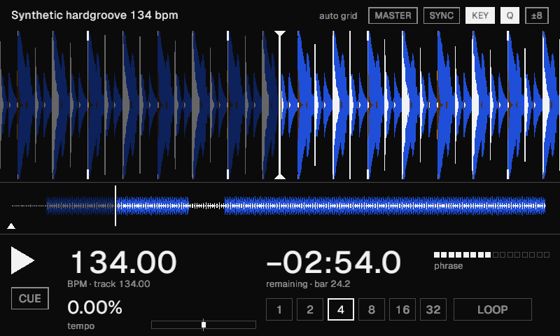
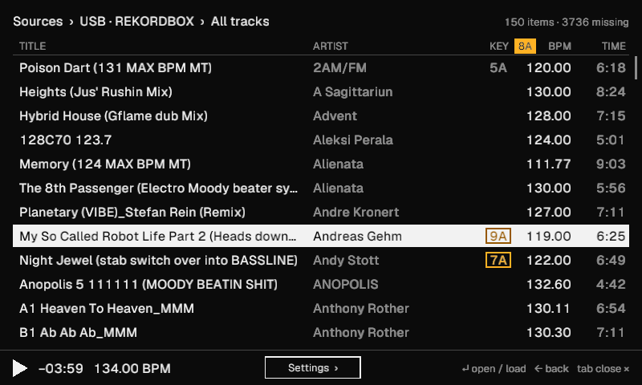
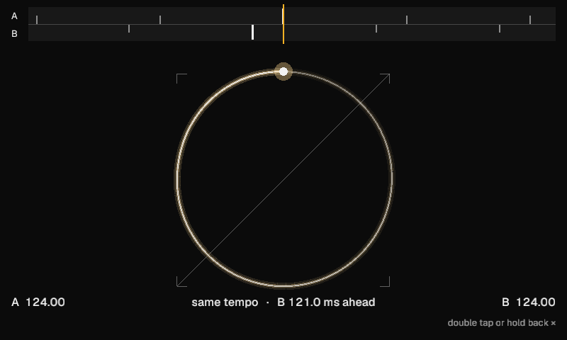

# kdj

A DJ deck in Rust, one per Raspberry Pi. Each Pi plays one deck into a
channel of an Allen & Heath Xone:96. Two Pis make decks A and B, and a
Xone:K3 plugged into either of them plays both. kdj reads Rekordbox USB
exports the way a CDJ does, so tracks arrive with their beat grids,
waveforms and cues.

kdj is a work in progress, at version 0.3. Two Pis run it at home for
practice sets; the interface, the settings and the enclosure keep
changing.



## The rig

| Part | What it is |
|---|---|
| Computer | Raspberry Pi 4 (the enclosure takes a Pi 5 too) |
| Audio | InnoMaker HiFi DAC HAT (PCM5122, the HiFiBerry DAC+ driver), line out to the mixer |
| Screen | Hosyond 5" DSI touchscreen, 800×480 |
| Controller | Xone:K3, split down the middle: deck A on the left, deck B on the right |
| Mixer | Xone:96 |
| Network | Ethernet between the Pis, carrying controls, Ableton Link and shared sticks |

The Pi boots from an SD card image straight into the deck, full screen,
with no desktop. [`deploy/pi`](deploy/pi/README.md) builds that image and
sets up the DAC, USB mounting and the service.

## What it does

### Tracks

Plug in a Rekordbox USB stick and the browser lists its playlists and
tracks. A track Rekordbox analysed brings its grid, three-band waveform,
memory cue and hot cues. kdj analyses anything else on load and marks it
"auto grid". MP3s with a LAME header land where Rekordbox's grid expects
them, because the decoder keeps the encoder's lead-in the way Rekordbox
does.

The kdjs share their sticks. A track loads onto either deck whichever Pi
holds its stick; it crosses the network whole and plays from memory, so
the stick can come out once the track is on.

The browser shows keys on the Camelot wheel (Settings › Display switches
to Rekordbox's names) and marks the tracks that mix with the one playing
on the other deck: the same key on an amber block, a neighbour on the
wheel boxed in amber.



### Playing

CDJ-style cue, hot cues A to H, beat loops and beat jumps, quantize, key
lock (Signalsmith Stretch), nudging, and a ±8 or ±16 tempo range. A
tempo fader on the controller takes over once it reaches the deck's tempo,
so nothing jumps. The audio thread runs at realtime priority on 128-frame
buffers, 2.7 ms at 48 kHz.

### Sync

Every deck joins the Ableton Link session on the network. One deck holds
MASTER across all the Pis, as with CDJs. When the master stops, the next
deck playing on SYNC takes MASTER over. SYNC matches tempo and bars, then
holds the beat and keeps any nudge you added.

To beatmatch by ear with SYNC off, double tap the deck screen for the sync
view. A strip across the top shows both decks' beat markers, CDJ-style.
Below it, a Lissajous figure turns while the tempos differ, holds still
when they match, and folds onto the diagonal in phase, pulsing on the
beat. The other deck can sit on the other Pi: Link's session beat gives
both Pis one clock to place each other's beats by.



### Screen and controls

You can touch anything on screen: play, cue, the loop sizes, the badges,
and the overview strip for needle search while stopped. The ‹ at the top
left of the browser and settings goes back a step, and holding a K3
encoder's push does the same. The K3's LEDs follow each deck's state.
MIDI learn maps other controllers.

- K3 layout: [`config/xone-k3.toml`](config/xone-k3.toml), with a
  drawing in [`docs/xone-k3.svg`](docs/xone-k3.svg)
- Keyboard: [`crates/kdj-engine/src/keymap.rs`](crates/kdj-engine/src/keymap.rs),
  with overrides through `--keymap FILE`
- Every screen state: [`docs/screens`](docs/screens/README.md)

## Unfinished

- The settings screen shows more than it controls. Key names, the deck
  letter and Wi-Fi take effect. Key lock, quantize, zoom, the phase meter
  and the rest show a value and change nothing yet, and no setting
  survives a restart.
- With quantize on, a hot cue pressed a few milliseconds before the beat
  plays a sliver of audio from before the cue.
- The boot splash (logo, then a progress bar) isn't built.
- The enclosure exists in CAD and in test prints.

## Develop

You need Rust (the version in `rust-toolchain.toml`), SDL2 (`brew install
sdl2` on macOS), and cmake with libclang for Link. Build without Link
with `--no-default-features`.

```bash
make dev          # the deck in a window, rebuilt on every change
make story-live   # every screen, redrawn on every change: http://localhost:8710
make check        # lint, tests, scripted scenarios
make deploy       # this checkout onto the Pis over SSH, no reflash
make image        # an SD card image, then `make flash` to write one
```

`make hooks` turns on a pre-commit hook that redraws `docs/screens`, so a
commit's diff shows what it did to each screen. `make linux` lints, tests
and builds for the Pi's arm64 in Docker.

`kdj-sim` runs the deck headless on a virtual audio clock: scripted
scenarios, perf budgets, PNG frames, a key lock listening test, and a
comparison of kdj's grid detection with your Rekordbox grids. The top of
[`crates/kdj-sim/src/main.rs`](crates/kdj-sim/src/main.rs) lists its
commands.

`cargo test` runs the fast suite. `cargo test -- --ignored` adds the slow
ones: a sweep over 16 tempos and a row-by-row check against rekordcrate on
a 3,900-track export.

## Layout

| Path | Contents |
|---|---|
| `crates/kdj-engine` | Transport, loops, hot cues, nudging, key lock, sync, fallback analysis. No I/O, no UI. |
| `crates/kdj-library` | Rekordbox data: `export.pdb`, analysis files, keys on the Camelot wheel |
| `crates/kdj-ui` | The 800×480 screen in OpenGL (3.3 core, ES 3.0) |
| `crates/kdj` | The app: SDL2 window, audio, touch, MIDI, Link, the network between kdjs |
| `crates/kdj-sim` | The headless simulator and the screen storybook |
| `crates/kdj-flash` | SD cards: what's on them, and writing the image to one |
| `deploy/pi` | Raspberry Pi setup and the image build |
| `hardware/enclosure` | The enclosure: CAD (build123d, OpenSCAD), parts on hand, test prints |
| `docs` | Screens, the K3 drawing, plans |

## Licence

GPL-3.0-or-later (see `LICENSE`), because kdj links Ableton Link, which is
GPL-2.0-or-later. Geist (in `assets/fonts`) is under the SIL Open Font
License 1.1. The test fixtures in `crates/kdj-library/tests/fixtures` come
from rekordcrate (MPL-2.0).
